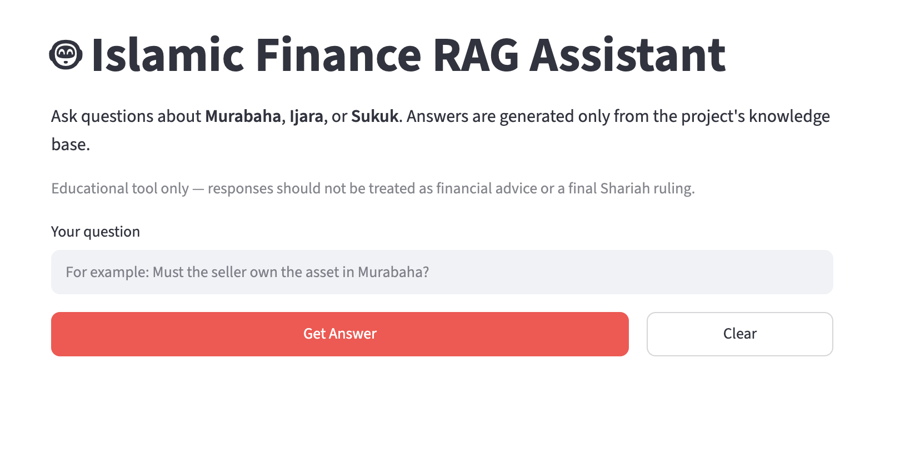
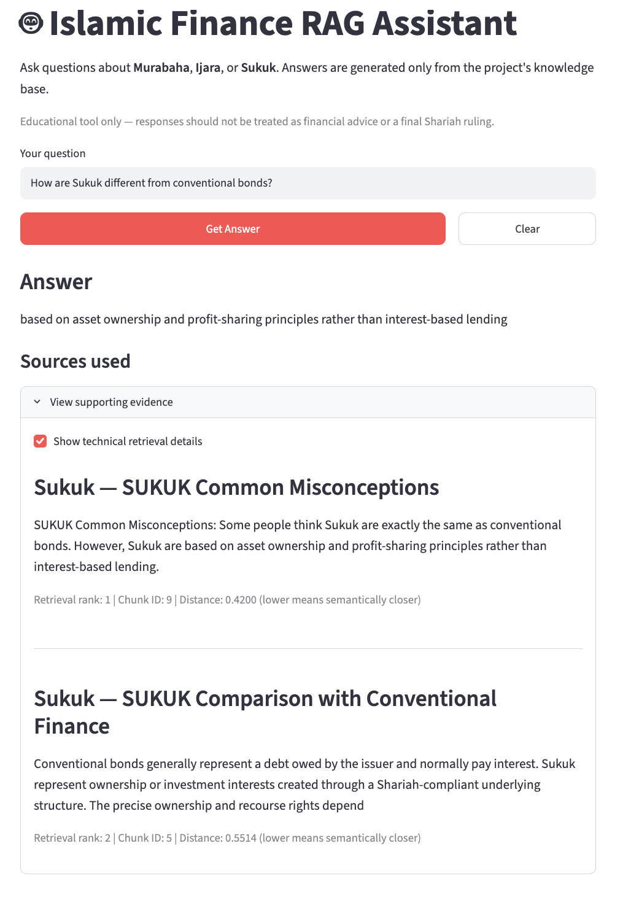
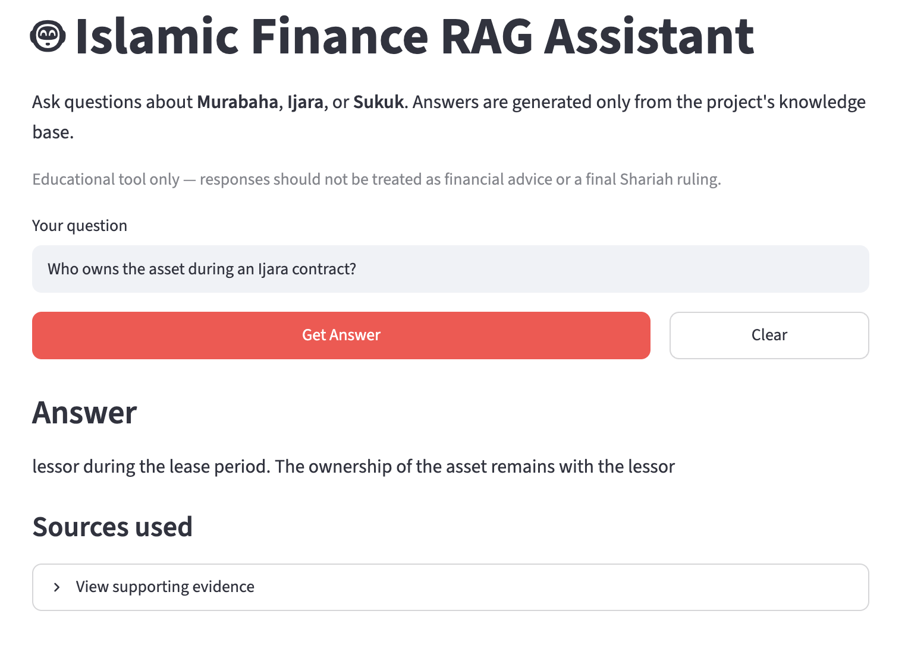
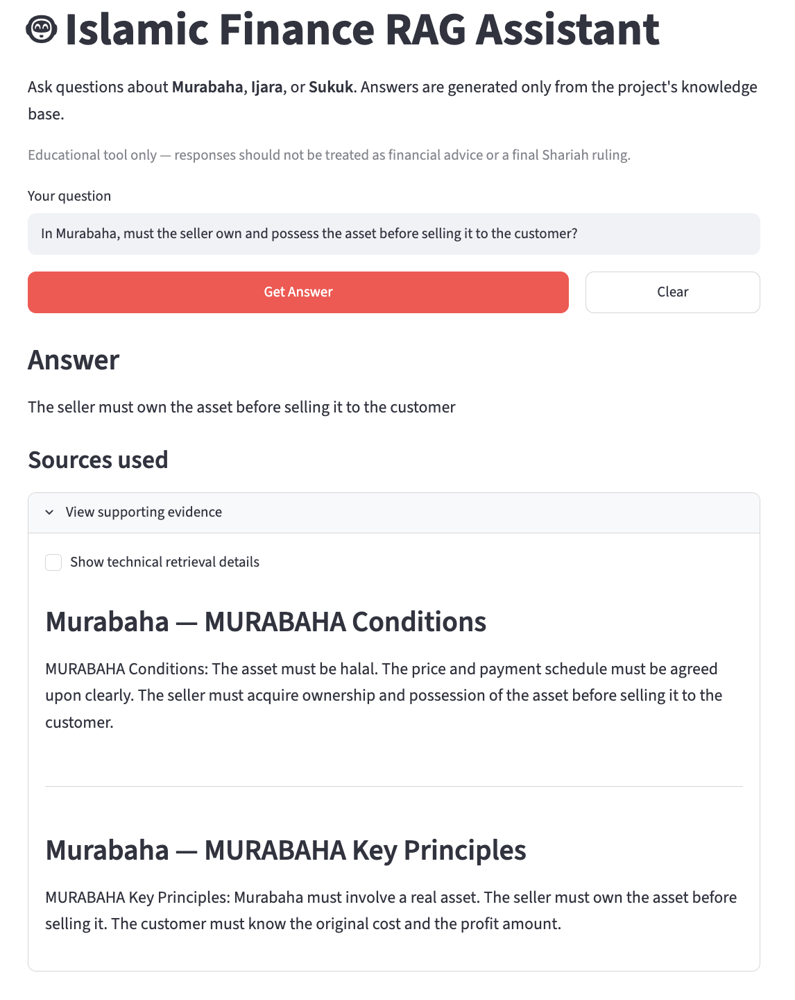

# Islamic Finance RAG Assistant

A Retrieval-Augmented Generation (RAG) application that answers questions about Murabaha, Ijara, and Sukuk using information retrieved from a curated Islamic finance knowledge base.

The application combines semantic retrieval, metadata filtering, and FLAN-T5 answer generation. It also displays supporting evidence so users can understand why particular information was retrieved.

## Project Goal

This project was built as part of my journey to specialize in Retrieval-Augmented Generation, large language models, and AI applications for Islamic finance.

The project demonstrates the complete RAG pipeline:

1. Load Islamic finance documents.
2. Divide documents into section-aware chunks.
3. Convert chunks into embeddings.
4. Store embeddings and metadata in ChromaDB.
5. Detect the contract mentioned in the question.
6. Retrieve semantically relevant chunks.
7. Generate an answer using the retrieved context.
8. Display supporting evidence and retrieval details.
9. Evaluate contract detection, retrieval, and generation separately.

## Supported Topics

The current knowledge base covers:

- Murabaha
- Ijara
- Sukuk

Each document contains structured sections such as definitions, principles, conditions, examples, comparisons, risks, and common misconceptions.

## Features

- Section-aware document chunking
- SentenceTransformer embeddings
- ChromaDB vector storage
- Semantic similarity retrieval
- Contract-based metadata filtering
- Retrieval ranking and distance display
- Source, section, and chunk metadata
- FLAN-T5 grounded answer generation
- Fallback responses for unsupported questions
- Cached embedding and generation models
- Persistent Streamlit results using session state
- Optional technical retrieval details
- Automated evaluation framework
- Streamlit interface with loading and clear controls

## Tech Stack

- Python
- Streamlit
- ChromaDB
- SentenceTransformers
- Hugging Face Transformers
- PyTorch
- LangChain text splitters

## Project Structure

```text
islamic-finance-rag-assistant/
├── .streamlit/
│   └── config.toml
├── data/
│   ├── ijara.txt
│   ├── murabaha.txt
│   └── sukuk.txt
├── screenshots/
│   ├── home.png
│   ├── ijara.png
│   ├── murabaha.png
│   └── retrieval.png
├── app.py
├── evaluation.py
├── generator.py
├── ingest.py
├── retriever.py
├── test_cases.py
├── .gitignore
├── README.md
└── requirements.txt
```

## Module Responsibilities

- `app.py`: Streamlit interface and application state
- `ingest.py`: Document loading, section-aware chunking, embeddings, and vector-store creation
- `retriever.py`: Contract detection and semantic retrieval
- `generator.py`: Model loading, prompt construction, and answer generation
- `evaluation.py`: Evaluation runner and result reporting
- `test_cases.py`: Structured evaluation cases
- `data/`: Islamic finance knowledge-base documents

## Installation

This version was tested with Python 3.13.

### 1. Clone the repository

```bash
git clone https://github.com/khaoula7/islamic-finance-rag-assistant.git
cd islamic-finance-rag-assistant
```

### 2. Create a virtual environment

```bash
python3 -m venv venv
```

### 3. Activate the virtual environment

On macOS or Linux:

```bash
source venv/bin/activate
```

On Windows:

```bash
venv\Scripts\activate
```

### 4. Install the dependencies

```bash
python -m pip install -r requirements.txt
```

The embedding and generation models may be downloaded the first time the application runs.

## Run the Application

```bash
streamlit run app.py
```

Then open the local URL displayed by Streamlit.

## Example Questions

- In Murabaha, must the seller own the asset before selling it?
- In Ijara, who owns the asset during the lease?
- What is Sukuk?
- How is Sukuk different from a conventional bond?
- What was the total global Sukuk issuance volume in 2025?

The final question tests whether the system refuses to provide information that is not available in the knowledge base.

## Explainable Retrieval

For each supported question, the application can display:

- Retrieved document text
- Source contract
- Document section
- Retrieval rank
- Chunk ID
- Chroma distance

A lower distance means that the retrieved chunk is semantically closer to the question. However, distance should not be interpreted as a guaranteed confidence score.

## Evaluation

Run the evaluation framework with:

```bash
python evaluation.py
```

The evaluation examines three parts of the RAG pipeline separately:

1. Contract detection
2. Retrieval evidence
3. Answer generation

### Current Results

| Component | Result |
|---|---:|
| Contract detection | 5/5 |
| Retrieval evidence | 3/3 |
| Generation | 3/5 |
| Overall | 3/5 |

These results show that contract detection and retrieval are currently reliable on the small test set. Generation remains the main limitation.

Correct retrieval does not guarantee a correct generated answer. The language model may produce shortened wording, vary the fallback response, or add unsupported information.

## Screenshots

### Home



### Sukuk Question and Retrieval



### Ijara Question



### Murabaha Question



## Challenges and Lessons LearnedWhat I Learned

During development, I discovered that:

- How chunk structure affects retrieval quality
- How embeddings represent semantic meaning
- How vector databases rank retrieved chunks
- Why retrieval distance is not the same as confidence
- How metadata filtering reduces cross-contract retrieval
- How knowledge-base quality affects retrieval
- Why retrieval and generation require separate evaluation
- How evaluator design can affect PASS/FAIL results
- How caching and session state affect Streamlit applications
- How retrieval evidence improves transparency and debugging

## Known Limitations

- The knowledge base currently contains only three Islamic finance topics.
- Contract detection depends on a supported contract name appearing in the question.
- The evaluation set is small and is not a complete measure of system quality.
- Retrieval distances are model-specific and are not calibrated confidence scores.
- FLAN-T5 may produce incomplete or unsupported responses even when retrieval is correct.
- ChromaDB is currently created in memory when the application starts.
- The content is educational and does not replace professional financial or Shariah advice.

## Future Improvements

- Expand the verified Islamic finance knowledge base
- Add PDF document ingestion
- Add contracts such as Musharakah, Mudarabah, Salam, and Istisna
- Improve contract routing beyond direct keyword detection
- Add retrieval thresholds for weak evidence
- Use a stronger instruction-following language model
- Connect answers to exact source sections with citations
- Expand the evaluation dataset
- Add semantic and human evaluation methods
- Persist the ChromaDB collection between sessions

## Disclaimer

This application is an educational prototype. Its responses should not be treated as financial advice, legal advice, or a final Shariah ruling. Important decisions should be reviewed by qualified Islamic finance and Shariah professionals.